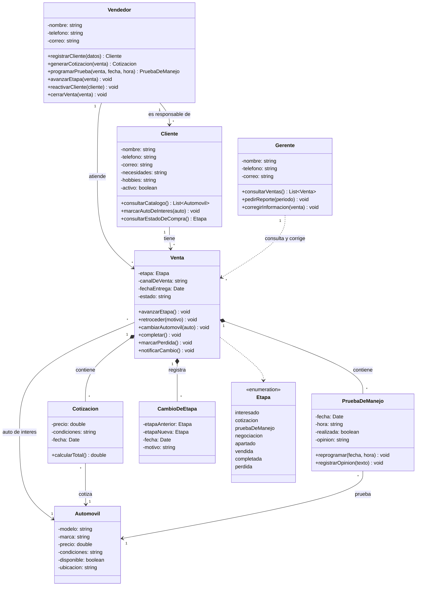
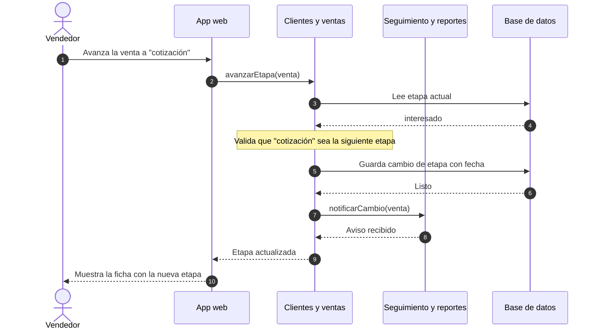
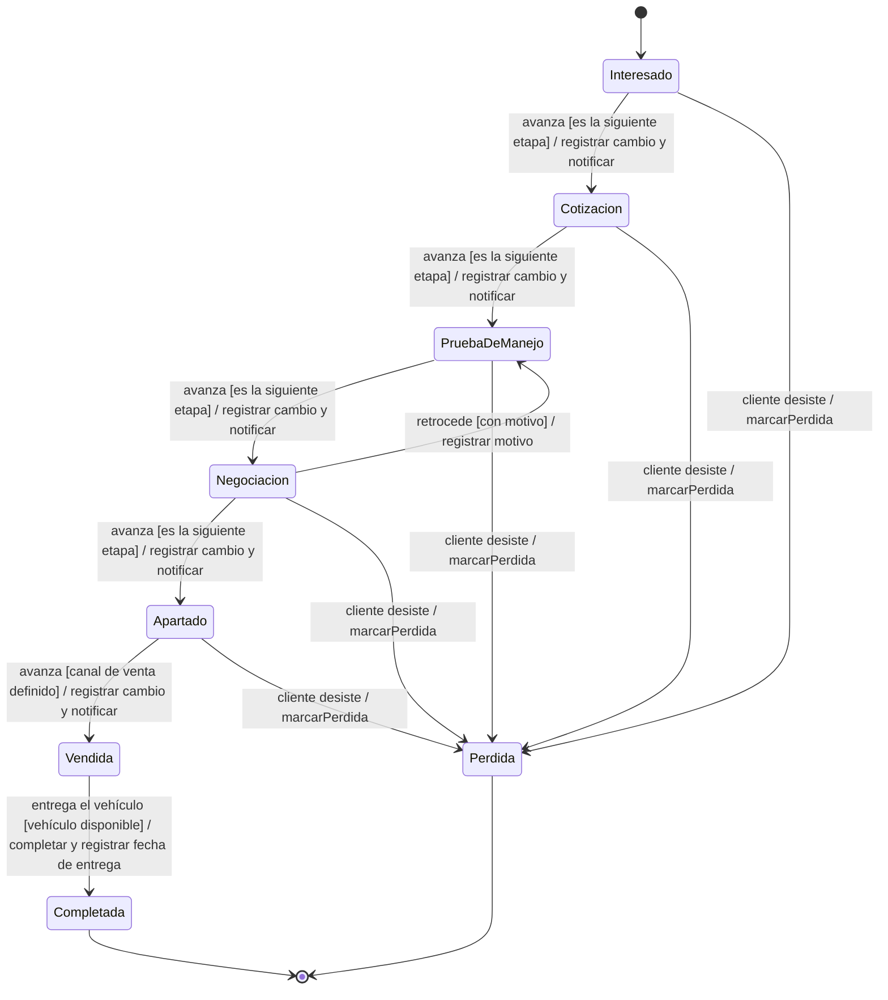

# Modelo UML de AutoTrack

Modelo estructural (clases) y de comportamiento (secuencia y estados), en texto de Mermaid.

## Diagrama de clases

## Diagrama de secuencia: avanzar la etapa de venta (CU-04)

## Diagrama de estados: ciclo de vida de la venta

## Concordancia entre diagramas

| Secuencia (CU-04) | Clases | Estados |
|---|---|---|
| Mensaje 2, `avanzarEtapa(venta)` | `Venta.avanzarEtapa()` y `Vendedor.avanzarEtapa(venta)` | Transición "avanza" |
| Nota de validación, "sea la siguiente etapa" | Regla dentro de `Venta.avanzarEtapa()` | Guarda `[es la siguiente etapa]` |
| Mensaje 5, "Guarda cambio de etapa con fecha" | Clase `CambioDeEtapa` (etapaAnterior, etapaNueva, fecha, motivo) | Acción "registrar cambio" |
| Mensaje 7, `notificarCambio(venta)` | `Venta.notificarCambio()` | Acción "notificar" |
| Mensaje 3, "Lee etapa actual" | Atributo `Venta.etapa` | Estado actual de la venta |
| Etapas "interesado" y "cotización" | Enumeración `Etapa` | Estados `Interesado` y `Cotizacion` |
